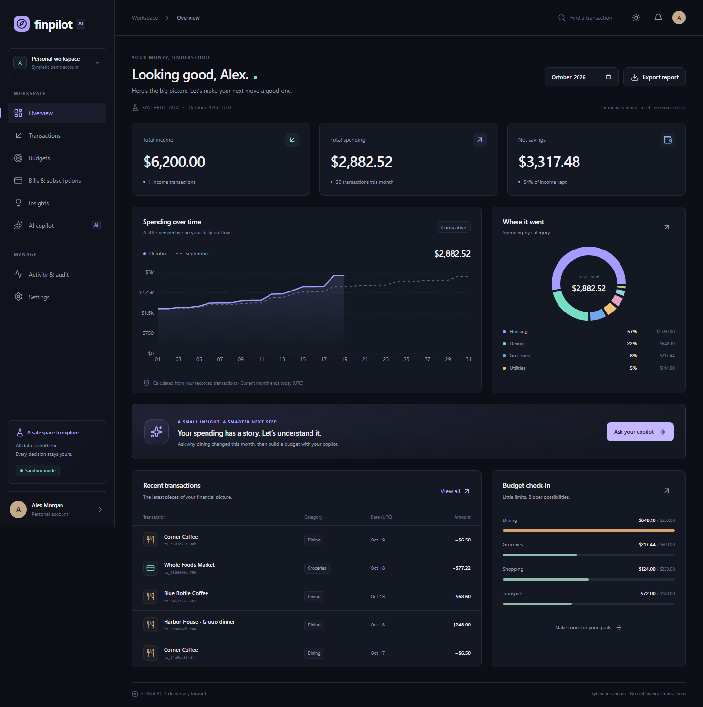

# FinPilot AI

**Your money, understood.** An explainable personal finance sandbox built for Topic A of the 2026 Shenzhen International FinTech Competition.

FinPilot connects transaction analysis to a completed budgeting task: inspect the evidence, review an exact proposal, and approve or reject the change. Financial calculations run on the server using integer USD cents. An optional language model selects tools; a separate approval endpoint applies changes.

[](https://github.com/Shariar-Joy/finpilot-ai/actions/workflows/ci.yml)



## Implemented features

- Dashboard with monthly income, spending, savings, category totals, and spending comparisons.
- Transaction search and filters, category editing, and CSV import with preview, validation, deduplication, and atomic writes. Try the [sample CSV](public/sample-transactions.csv); select October 2026 after importing its fixed-date records.
- Budget management, progress alerts, inferred recurring bills, in-app reminders, and unusual-spending explanations linked to transactions.
- Finance copilot with visible tool results, exact proposals, explicit approval or rejection, and an audit trail. Approval tokens expire after five minutes and can be consumed only once.
- User-scoped accounts, revocable sessions, monthly CSV/PDF exports, responsive navigation, and light/dark themes.
- Optional PostgreSQL persistence, private Python analytics, and OpenAI tool planning. The keyless deterministic agent completes the demo independently.

## Architecture

The React interface uses a same-origin Next.js API. Server-side validation and authentication select the user's ledger; deterministic tools calculate results and create proposals. Approval consumption, financial changes, and audit entries commit together. Prisma stores users, sessions, and JSONB ledgers in PostgreSQL, or an explicit single-process demo uses memory. The optional FastAPI service independently calculates monthly summaries and cannot modify financial records.

Stack: Next.js App Router, React, TypeScript, Tailwind CSS, Recharts, Prisma/PostgreSQL, and Python/FastAPI.

See [architecture](docs/architecture.md) and [algorithms](docs/algorithms.md) for implementation details and tradeoffs.

## Setup and installation

Use **Node.js 24.x** and npm. Run commands from the directory containing `package.json` (`FinPilot_AI_Code/FinPilot AI` in the supplied workspace):

```powershell
npm ci
npm run dev
```

Open **http://127.0.0.1:3000** and choose **Explore the live demo**. This creates a fresh account named Shariar Joy with 90 days of synthetic transactions. No database, Python service, or API key is required. Registration is also available with a password of at least 12 characters and at most 72 UTF-8 bytes; email addresses are not verified.

**Memory-mode data is lost when the server restarts.** Use one server process. A configured but unavailable PostgreSQL database returns an error instead of falling back to memory.

### PostgreSQL persistence

Copy `.env.example` to `.env`, then set `DATABASE_URL`, `APP_ORIGIN`, a random `SESSION_SECRET` of at least 32 characters, and a `DEMO_PASSWORD` of at least 12 characters. Generate a secret locally:

```powershell
node -e "console.log(require('crypto').randomBytes(48).toString('hex'))"
```

With Docker Desktop running, set `POSTGRES_PASSWORD` in your shell to the password used in `DATABASE_URL`, then:

```powershell
docker compose up -d postgres
npm run db:migrate
npm run seed
npm run dev
```

The seed command loads `.env` and creates `demo@finpilot.local` using `DEMO_PASSWORD`; it leaves an existing account unchanged. The demo button creates a separate workspace. Use migrations for persistent deployments; `npm run db:push` is available for disposable development databases.

### Optional Python analytics

Use Python 3.13 or newer. In a separate terminal:

```powershell
python -m venv .venv
.\.venv\Scripts\python.exe -m pip install -r services/analytics/requirements.txt
$env:ANALYTICS_SERVICE_TOKEN = 'YOUR_GENERATED_SERVICE_SECRET'
.\.venv\Scripts\python.exe -m uvicorn main:app --app-dir services/analytics --host 127.0.0.1 --port 8000 --no-access-log
```

Set the same `ANALYTICS_SERVICE_TOKEN` and `ANALYTICS_URL=http://127.0.0.1:8000` in the application's `.env`, restart Next.js, and choose **Settings > Python analysis service > Verify**. Alternatively, with the token set in your shell, run `docker compose up -d analytics`. Only user-scoped transaction IDs, dates, categories, and integer amounts are forwarded. The core demo works while this service is offline.

### Optional model planning

Set the server-only `OPENAI_API_KEY` and optionally `OPENAI_MODEL` in `.env`, then restart the app. The configured default is `gpt-4.1-mini`; use a Responses-compatible model available to your account. Provider failures or invalid plans fall back to the deterministic agent. Tests mock provider responses; retained evidence does not verify live paid-model execution.

### Production startup

Builds require no credentials or live database. For persistent deployment, configure PostgreSQL, apply migrations, set `DEMO_MODE=false`, a persistent `SESSION_SECRET`, and an HTTPS `APP_ORIGIN`. Run `npm run build` and `npm run start -- --hostname 0.0.0.0` behind a TLS reverse proxy with request and rate limits. Keep the analytics service private. An explicitly temporary preview can use `DEMO_MODE=true`; its memory storage remains ephemeral and single-process.

## Running tests

For isolated local checks, leave `DATABASE_URL` and `OPENAI_API_KEY` unset. Install the optional Python dependencies before its tests:

```powershell
npm run lint
npm run typecheck
npm run test
python -m pip install -r services/analytics/requirements.txt
python -m unittest discover -s services/analytics -v
npm run build
npx playwright install chromium
npm run test:e2e
```

Playwright starts a development server automatically. Its default URL is `http://127.0.0.1:3000`; keep `APP_ORIGIN` consistent with the browser URL. To use a separate port, set both `APP_ORIGIN` and `E2E_BASE_URL` to that origin and set `FINPILOT_VERIFY_RUN=true` to require a fresh server.

Vitest covers calculations, ownership, authentication, CSV handling, provider boundaries, approval binding, concurrency, and rollback. Chromium scenarios exercise the complete user workflows and mobile rendering. CI also runs the TypeScript suite against PostgreSQL.

The [retained execution record](docs/execution-evidence.md) links original JSON, logs, screenshots, and video. Routine checks above leave those evidence files unchanged. `npm run verify` deliberately replaces test evidence under `docs/evidence/`; `node scripts/collect-evidence.mjs` validates the captured run and updates its summary. Use these, the benchmark, and capture/recording scripts only when intentionally refreshing evidence. `node scripts/verify-services.mjs` checks a running Next.js/FastAPI integration; see its base-URL setting before running it.

## Demo instructions

1. Start the app, open the local URL, and choose **Explore the live demo**.
2. Open **AI copilot > Run demo scenario**. Inspect the tools, transaction references, and proposed next-month dining budget.
3. Reject the proposal and confirm the budget is unchanged.
4. Run the scenario again and approve it. In **Budgets**, select the proposal's target month and check the exact saved limit.
5. Open **Activity & audit** to inspect both decisions.

Follow the [five-minute demo script](docs/demo-script.md), or view the [retained application recording](docs/evidence/demo.webm). Accounting months and seed generation use UTC; use the actual values shown by the app.

## Security limitations

This is a synthetic sandbox. It has no bank connection, payment execution, external notification delivery, email verification, MFA, or password recovery. Inferred bills and unusual-spending rules are descriptive. Model-selected proposals can be incorrect and require human review.

Memory storage and rate limits are process-local. The JSONB ledger and application-owned audit trail require further scaling, retention, and operational hardening for real users. Live-model reliability, hosted production operation, and independent penetration testing are unverified. No regulatory certification is claimed.

Keep `.env`, credentials, session/approval tokens, and real financial records out of Git. See the [security assessment](docs/security-self-assessment.md) and [security reporting policy](SECURITY.md).

## Competition materials and documentation

The six completed competition deliverables are maintained separately in `FinPilot_AI_Doc` in the supplied workspace. This repository contains the runnable application, technical documentation, and original evidence referenced by those reports. A public deliverables URL has not been provided.

[Requirements crosswalk](docs/competition-requirements.md) ? [Contributing](CONTRIBUTING.md) ? [License](LICENSE) ? [Third-party notices](THIRD_PARTY_NOTICES.md)

## Authors

- Shariar Nazim Joy
- Abrar Hossain Abir

Department of Computer Science and Engineering, Independent University, Bangladesh.
