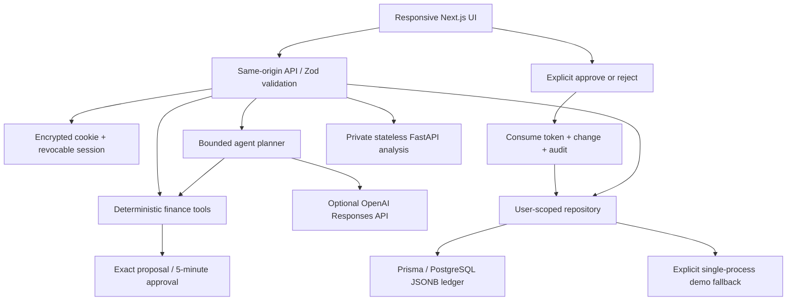

# Architecture

FinPilot is a Node.js Next.js App Router application with a same-origin JSON API. Client components provide responsive views; no credentials, database access, model calls or permissions logic runs in the browser. Tailwind is configured and a shared CSS design system supplies the interface. Recharts renders ledger-derived chart data; Lucide supplies icons. Accessible native dialogs handle focus containment and Escape.

## Data and atomicity

Prisma models `User`, `Session` and `Ledger` are relational, with ownership foreign keys. Each ledger holds validated transaction, budget, reminder, approval, message and audit arrays as JSONB. Integer cents remain integers inside JSON; dates are ISO UTC calendar strings. Runtime schemas bound individual amounts to $1 million and reject unsafe aggregate totals.

The aggregate design intentionally favors a small, reviewable competition implementation. A mutation reads a ledger/version, copies it, applies a synchronous operation, then executes an atomic `UPDATE ... WHERE userId = ? AND version = ?`, incrementing the version. A losing concurrent write retries up to five times. Approval consumption, budget/reminder mutation and audit append share this update. A thrown exception discards all partial changes. In memory, the same copy-before-mutate behavior runs behind a process mutex. PostgreSQL outages return safe errors; they do not switch data stores.

User creation and its ledger are a nested Prisma write. Session issuance stores a SHA-256 token hash and expiry; the encrypted iron-session cookie contains the random session token and user ID. Every protected request validates both the cookie and the server record. Logout deletes the record. Passwords are bcrypt hashes (cost 12 for registered accounts); one-click demos use random unguessable passwords and cost 10 solely to reduce demo startup work.

All repository operations derive `userId` from the verified session. Resource IDs are searched only inside that user's ledger; caller-supplied user IDs have no authority. Public data responses remove token hashes and exact approval tokens. Approval tokens are returned once to the originating tab and kept in its sessionStorage until use.

## Agent execution

The deterministic agent recognizes supported finance intents and calls the same real tool executor used by optional model planning. Six read tools and two propose tools are available to the planner. Its maximum batch is eight calls, provider timeout 12 seconds, total execution guard 20 seconds. Proposals are computed from a ledger snapshot. Their immutable payload, rather than a later recalculation, is approved; concurrent new transactions do not silently change the reviewed amount.

The OpenAI integration uses strict function schemas and a single stateless planning request. It does not send financial records or merchant content to the provider: only the user's question, current date, and schemas. It executes the validated plan locally, then generates a grounded response from deterministic outputs. It does not perform a second model narration call or promise broad general conversation. Provider failures and malformed plans fall back before financial mutations. Live model behavior has to be checked with a real key separately.

`apply_budget_change` and `apply_bill_reminder` are reachable only through the approval decision path. The model cannot request them. Direct UI CRUD (budget forms, category edits, CSV import, reminder completion) requires a user-facing confirmation plus a server-validated confirmation flag. Manual forms are explicit user actions and are separate from the agent token policy.

Audit events record actual tool execution and decisions, with actor, correlation ID, decision, timestamp and a small allowlisted metadata object. Mutation events also appear in the conversation's tool timeline. Financial evidence links resolve transaction IDs in the transactions page, including their original month.

## Python boundary

FastAPI independently calculates income, expenses, net savings and category totals for a supplied month. Next.js authenticates the user and forwards only that user's IDs, dates, integer amounts and validated categories. It authenticates with a server-only shared token. Python is stateless and cannot read the database, call the model, or mutate budgets. The request is bounded to 2 MB / 10,000 rows; Next.js applies a 3-second service timeout. The TypeScript analysis keeps the core demo available without Python.

## Scaling tradeoffs

The ledger aggregate simplifies atomicity but rewrites a user's JSONB document per change and does not support efficient large-scale analytical indexes. Normalize financial rows and append audit events to a separately protected store before high-volume use. Process-local rate limits require a shared store or gateway for multiple replicas. The in-memory fallback must use one long-lived process; it cannot provide serverless persistence. Email verification, recovery, MFA, payment rails and regulated advice are excluded.

Implementation references: [Next.js Route Handlers](https://nextjs.org/docs/app/api-reference/file-conventions/route), [OpenAI function calling](https://developers.openai.com/api/docs/guides/function-calling), [Prisma PostgreSQL connector](https://www.prisma.io/docs/orm/v6/overview/databases/postgresql), [FastAPI request bodies](https://fastapi.tiangolo.com/tutorial/body/).
